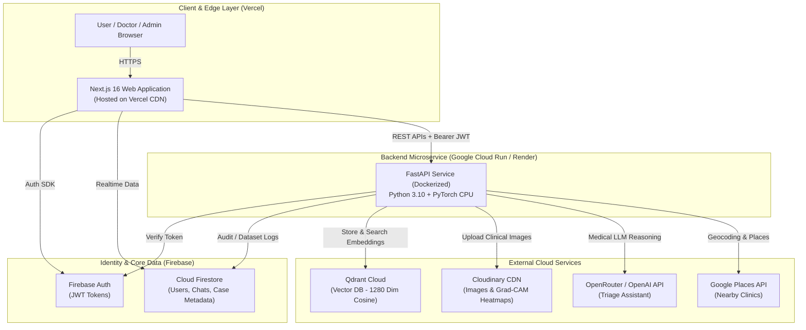

# AI Derma Assistant — Production Deployment & Go-Live Playbook
**Document Version:** 1.0  
**Target Architecture:** Multi-Cloud Serverless / PaaS (Vercel + Google Cloud Run / Render + Firebase + Qdrant Cloud + Cloudinary)  
**Status:** Canonical Deployment Blueprint

---

## 1. Executive Summary & Architecture Overview

The **AI Derma Assistant** is a full-stack, AI-powered dermatological triage platform consisting of:
1. **Frontend:** Next.js 16 (App Router), React 19, Tailwind CSS v4, Framer Motion.
2. **Backend:** FastAPI (Python 3.10), Uvicorn, PyTorch (EfficientNet-B0), Grad-CAM, OpenCV.
3. **Databases & Managed Services:**
   - **Firebase Authentication & Cloud Firestore:** User identities, role-based access (Patient, Doctor, Admin), chat history.
   - **Qdrant Vector Database:** 1280-dimensional image embedding index for visual case similarity.
   - **Cloudinary:** Secure media storage for clinical skin images and Grad-CAM heatmaps.
   - **OpenRouter / OpenAI:** LLM triage companion and empathetic guidance.
   - **Google Places API:** Nearby dermatologist discovery.



---

## 2. Pre-Deployment Code Adjustments (Critical Blockers)

Before deploying to live cloud infrastructure, the following **7 code modifications** must be completed.

### Blocker 1: Dynamic Frontend API Base URL
- **Current State:** `frontend/src/components/ChatDashboard.tsx` and `DoctorDashboard.tsx` contain hardcoded `http://localhost:8000`.
- **Required Fix:** Replace literal URLs with `process.env.NEXT_PUBLIC_API_URL`.
- **Implementation:**
  Create `frontend/src/lib/api.ts`:
  ```typescript
  export const API_BASE_URL = process.env.NEXT_PUBLIC_API_URL || "http://localhost:8000";
  ```
  Update calls:
  ```typescript
  // Before:
  const res = await fetch('http://localhost:8000/api/upload-image', ...)
  // After:
  const res = await fetch(`${API_BASE_URL}/api/upload-image`, ...)
  ```

---

### Blocker 2: ML Model Path Resolution in Container
- **Current State:** In `backend/app/services/ml_service.py`:
  ```python
  WORKSPACE_ROOT = Path(__file__).resolve().parents[3]
  SKIN_MODEL_PATH = WORKSPACE_ROOT / "ml" / "skin_model.pth"
  ```
  In a Docker build where only `backend/` is copied, `parents[3]` points outside the container workdir, triggering `FileNotFoundError`.
- **Required Fix:** Use an environment variable with a safe container fallback:
  ```python
  DEFAULT_MODEL_PATH = Path(__file__).resolve().parent.parent / "models" / "skin_model.pth"
  MODEL_ENV_PATH = os.getenv("SKIN_MODEL_PATH")
  SKIN_MODEL_PATH = Path(MODEL_ENV_PATH) if MODEL_ENV_PATH else DEFAULT_MODEL_PATH
  ```
  Ensure `ml/skin_model.pth` is copied into `backend/app/models/skin_model.pth` during Docker packaging.

---

### Blocker 3: Qdrant Ephemeral Storage to Managed Cloud
- **Current State:** `vector_service.py` initializes:
  ```python
  client = QdrantClient(path="./qdrant_storage")
  ```
  In serverless containers (Cloud Run / Render), the local disk is wiped on scale-down, erasing vector data.
- **Required Fix:** Enable Qdrant Cloud connectivity via environment variables:
  ```python
  QDRANT_URL = os.getenv("QDRANT_URL")
  QDRANT_API_KEY = os.getenv("QDRANT_API_KEY")

  if QDRANT_URL:
      client = QdrantClient(
          url=QDRANT_URL,
          api_key=QDRANT_API_KEY,
          prefer_grpc=False
      )
  else:
      client = QdrantClient(path="./qdrant_storage")
  ```

---

### Blocker 4: Secure Root / Super-Admin Authentication
- **Current State:** `frontend/src/app/super-admin/page.tsx` checks credentials in plain text client-side:
  ```typescript
  if (username === 'Rohit' && password === '29032005') ...
  ```
  This is exposed to anyone inspecting compiled JavaScript bundles.
- **Required Fix:**
  1. Migrate Super-Admin auth to Firebase Custom Claims or Firestore role verification:
     ```typescript
     // Check if user has role: 'super-admin' in Firestore /users/{uid}
     ```
  2. If using hardcoded admin credentials temporarily, verify them inside a Next.js Server Route Handler (`/api/super-admin-auth`) via `process.env.SUPER_ADMIN_PASSWORD`, returning an HTTP-only secure session cookie.

---

### Blocker 5: Restrict Production CORS
- **Current State:** `backend/main.py` has `allow_origins=["*"]`.
- **Required Fix:** Allow only the production Vercel domain and custom domains:
  ```python
  ALLOWED_ORIGINS = os.getenv("ALLOWED_ORIGINS", "http://localhost:3000").split(",")

  app.add_middleware(
      CORSMiddleware,
      allow_origins=ALLOWED_ORIGINS,
      allow_credentials=True,
      allow_methods=["GET", "POST", "PUT", "DELETE", "OPTIONS"],
      allow_headers=["*"],
  )
  ```

---

### Blocker 6: Firestore Security Rules Enforcement
- **Current State:** `frontend/firestore.rules` contains `allow read, write: if true;`, which exposes patient records to the public.
- **Required Fix:** Enforce role and user-isolated security:
  ```javascript
  rules_version = '2';
  service cloud.firestore {
    match /databases/{database}/documents {
      function isAuthenticated() {
        return request.auth != null;
      }
      function isOwner(userId) {
        return isAuthenticated() && request.auth.uid == userId;
      }
      function isDoctorOrAdmin() {
        return isAuthenticated() && (
          request.auth.token.role == 'doctor' || 
          request.auth.token.role == 'admin' ||
          get(/databases/$(database)/documents/users/$(request.auth.uid)).data.role in ['doctor', 'admin']
        );
      }

      match /users/{userId} {
        allow read: if isAuthenticated();
        allow write: if isOwner(userId);

        match /chats/{chatId} {
          allow read, write: if isOwner(userId);

          match /messages/{messageId} {
            allow read, write: if isOwner(userId);
          }
        }
      }

      match /dataset_images/{imageId} {
        allow read: if isDoctorOrAdmin();
        allow write: if isDoctorOrAdmin();
      }
    }
  }
  ```

---

### Blocker 7: Secrets Sanitization & Git Hygiene
- Ensure the following files are strictly placed in `.gitignore` and never committed:
  - `backend/.env`
  - `backend/serviceAccountKey.json`
  - `passkeys.txt`
  - `frontend/.env.local`

---

## 3. Recommended Cloud Hosting Stack

| Component | Recommended Provider | Tier / Plan | Monthly Cost | Rationale |
|---|---|---|---|---|
| **Frontend** | **Vercel** | Hobby / Pro | **$0 / $20** | Native Next.js App Router support, instant build pipeline, global CDN. |
| **Backend API & ML** | **Google Cloud Run** | Pay-as-you-go | **$0 - $5** | Scales to zero, handles PyTorch containers, direct IAM with Firebase project `dermascan-79a5c`. |
| **Vector DB** | **Qdrant Cloud** | Managed Free Tier | **$0** | Free 1GB RAM cluster, permanently hosted, no server maintenance. |
| **Database & Auth** | **Firebase (Spark/Blaze)** | Pay-as-you-go | **$0** (generous free tier) | Already configured; manages user sessions and patient chat storage. |
| **Image CDN** | **Cloudinary** | Free Tier | **$0** (25 credits/mo) | Handles original lesions, transforms, and Grad-CAM overlays. |
| **LLM Provider** | **OpenRouter / OpenAI** | Pay-per-token | **~$2 - $5** | Cost-effective access to GPT-3.5/GPT-4o-mini for clinical explanation. |

*Total starting operational cost: **$0.00 to $10.00 / month**.*

---

## 4. Step-by-Step Deployment Guide

### Phase 1: Managed Services Setup

#### 1.1 Qdrant Cloud Vector Database
1. Go to [https://cloud.qdrant.io/](https://cloud.qdrant.io/) and create an account.
2. Click **Create Cluster** -> Select **Free Tier (1GB RAM, 0.5 vCPU)**.
3. Choose the region closest to your backend (e.g., `us-central1` or `europe-west3`).
4. Once provisioned, copy:
   - **Cluster URL:** `https://xxxxxxxx-xxxx-xxxx-xxxx-xxxxxxxxxxxx.us-east4-0.gcp.cloud.qdrant.io`
   - **API Key:** Click **Data access keys** -> **Create Key** -> copy string.
5. Save these as `QDRANT_URL` and `QDRANT_API_KEY`.

#### 1.2 Firebase Production Rules & Domain Authorization
1. Open the [Firebase Console](https://console.firebase.google.com/) for project `dermascan-79a5c`.
2. Navigate to **Firestore Database** -> **Rules** -> Paste the hardened rules from Section 2 (Blocker 6) -> Click **Publish**.
3. Navigate to **Authentication** -> **Settings** -> **Authorized domains**:
   - Add your Vercel deployment domain (e.g. `ai-derma-assistant.vercel.app`).
   - Add your custom domain (e.g. `derma.yourdomain.com`).

---

### Phase 2: Backend Containerization & Cloud Run Deployment

#### 2.1 Optimized Production Dockerfile
Create `backend/Dockerfile.prod` (using PyTorch CPU-only wheel to reduce image size from 4.5GB to ~900MB):

```dockerfile
FROM python:3.10-slim

WORKDIR /app

# Install system dependencies for OpenCV and Pillow
RUN apt-get update && apt-get install -y --no-install-recommends \
    libgl1-mesa-glx \
    libglib2.0-0 \
    && rm -rf /var/lib/apt/lists/*

# Copy dependency list
COPY requirements.txt .

# Install PyTorch CPU first to avoid heavy CUDA wheels
RUN pip install --no-cache-dir torch torchvision --index-url https://download.pytorch.org/whl/cpu

# Install remaining dependencies
RUN pip install --no-cache-dir -r requirements.txt

# Copy application code
COPY . .

# Copy model weights if stored in models folder
COPY ../ml/skin_model.pth ./app/models/skin_model.pth

# Set environment
ENV PORT=8080
ENV PYTHONUNBUFFERED=1
ENV SKIN_MODEL_PATH=/app/app/models/skin_model.pth

EXPOSE 8080

CMD ["uvicorn", "main:app", "--host", "0.0.0.0", "--port", "8080", "--workers", "2"]
```

#### 2.2 Deploying to Google Cloud Run
Using Google Cloud SDK:
```bash
# 1. Login to GCP
gcloud auth login
gcloud config set project dermascan-79a5c

# 2. Build image using Google Cloud Build
gcloud builds submit --tag gcr.io/dermascan-79a5c/derma-backend:latest ./backend

# 3. Deploy to Cloud Run
gcloud run deploy derma-backend \
  --image gcr.io/dermascan-79a5c/derma-backend:latest \
  --platform managed \
  --region us-central1 \
  --allow-unauthenticated \
  --memory 2Gi \
  --cpu 2 \
  --min-instances 0 \
  --max-instances 5    --set-env-vars "\
CLOUDINARY_CLOUD=your_cloudinary_cloud_name,\
CLOUDINARY_API_KEY=your_cloudinary_api_key,\
CLOUDINARY_SECRET=your_cloudinary_api_secret,\
OPENAI_API_KEY=your_openai_or_openrouter_api_key,\
QDRANT_URL=https://your-cluster.cloud.qdrant.io,\
QDRANT_API_KEY=your-qdrant-key,\
FIREBASE_STORAGE_BUCKET=dermascan-79a5c.firebasestorage.app,\
ALLOWED_ORIGINS=https://ai-derma-assistant.vercel.app"
```

*Note: For Firebase Admin credentials on Cloud Run, Google Cloud Run automatically uses Application Default Credentials (ADC) associated with the service account of `dermascan-79a5c`, eliminating the need to mount `serviceAccountKey.json`!*

---

### Alternative Backend Hosting: Render / Railway
If you prefer not to use Google Cloud Run CLI:
1. Push repository to GitHub.
2. In [Render.com](https://render.com), click **New +** -> **Web Service**.
3. Connect your repository, set Root Directory to `backend`, Environment to **Docker**.
4. Set Instance Type to **Standard (2GB RAM, 1 CPU)** (PyTorch inference requires >= 1.5GB RAM).
5. Add the environment variables under the **Environment** tab.
6. Render will build the container and provide a live URL (e.g., `https://derma-api.onrender.com`).

---

### Phase 3: Frontend Deployment on Vercel

1. Push your latest code to your GitHub / GitLab repository.
2. Visit [Vercel](https://vercel.com/) and click **Add New...** -> **Project**.
3. Import your GitHub repository.
4. Configure Project Settings:
   - **Framework Preset:** Next.js
   - **Root Directory:** `frontend`
5. Configure Environment Variables:
   | Key | Value | Description |
   |---|---|---|
   | `NEXT_PUBLIC_API_URL` | `https://derma-backend-xyz.a.run.app` | Cloud Run / Render backend URL |
   | `NEXT_PUBLIC_FIREBASE_API_KEY` | `your_firebase_api_key` | Firebase Web API Key |
   | `NEXT_PUBLIC_FIREBASE_AUTH_DOMAIN` | `dermascan-79a5c.firebaseapp.com` | Auth Domain | |
   | `NEXT_PUBLIC_FIREBASE_PROJECT_ID` | `dermascan-79a5c` | Project ID |
   | `NEXT_PUBLIC_FIREBASE_STORAGE_BUCKET`| `dermascan-79a5c.firebasestorage.app` | Storage Bucket |
   | `NEXT_PUBLIC_FIREBASE_MESSAGING_SENDER_ID`| `870395651327` | Sender ID |
   | `NEXT_PUBLIC_FIREBASE_APP_ID` | `1:870395651327:web:26683c56d7cc1ceb4018ca` | App ID |
6. Click **Deploy**.
7. Test the live build at `https://your-project.vercel.app`.

---

## 5. Domain Configuration & SSL (Custom Domain)

To present a professional clinical application, link your own custom domain (e.g., `dermassist.ai` or `yourclinic.com`).

### DNS Record Setup Table

| Subdomain | Type | Target / Value | Purpose |
|---|---|---|---|
| `app.yourdomain.com` | `CNAME` | `cname.vercel-dns.com` | Patient & Doctor Web App |
| `api.yourdomain.com` | `CNAME` | `ghs.googlehosted.com` (Cloud Run) or Render domain | FastAPI Backend & ML Services |

*SSL Certificates are automatically provisioned and renewed for free by Vercel and Google Cloud Run via Let's Encrypt / Google Trust Services.*

---

## 6. Post-Deployment Verification Matrix

Run through this test checklist immediately following deployment:

| Test ID | Module | Action | Expected Output | Status |
|---|---|---|---|---|
| **V-01** | Backend Health | Visit `https://api.yourdomain.com/` | `{"message": "AI Derma Assistant Backend Running"}` | [ ] |
| **V-02** | Auth Flow | Sign up new user via email/pass | Creates user record in Firebase Auth + Firestore `users/{uid}` | [ ] |
| **V-03** | ML Inference | Upload skin lesion sample in `/chat` | Returns prediction (e.g. `mel`, `nv`), confidence %, and severity score | [ ] |
| **V-04** | Heatmap Check | Inspect Grad-CAM visual output | Heatmap displays over lesion, hosted securely on Cloudinary CDN | [ ] |
| **V-05** | Vector DB | Check similar case retrieval | Returns top matching historical cases from Qdrant Cloud | [ ] |
| **V-06** | AI Chat | Send follow-up triage question | AI responds empathetically with non-diagnostic guidance | [ ] |
| **V-07** | Geolocation | Click "Find Nearby Dermatologists" | Fetches verified local clinics via Google Places API | [ ] |
| **V-08** | Doctor Portal | Sign in as doctor, upload verified case | Case writes to Firestore `dataset_images` with doctor attribution | [ ] |

---

## 7. Operational Monitoring & Disaster Recovery

1. **Uptime & Health Monitoring:**
   - Configure a free monitor using [UptimeRobot](https://uptimerobot.com) targeting `https://api.yourdomain.com/` (alerting on 5xx status codes or response times > 5000ms).
2. **Error Logging:**
   - Integrate Sentry (`@sentry/nextjs` for frontend, `sentry-sdk` for FastAPI) to receive instant notifications of client or backend exceptions.
3. **Database Backups:**
   - Enable scheduled automated backups for Google Cloud Firestore via Google Cloud Console (`gcloud firestore export gs://[BUCKET_NAME]`).
   - Create periodic Qdrant collection snapshots via Qdrant Cloud dashboard.
4. **Model Rollback Strategy:**
   - Store versioned weights in Cloud Storage: `models/skin_model_v1.0.pth`, `models/skin_model_v1.1.pth`.
   - Update `SKIN_MODEL_PATH` environment variable in Cloud Run to roll back within 60 seconds without re-deploying code.

---

## 8. Regulatory, Medical & Legal Compliance Notice

1. **Mandatory Disclaimer:** The platform must display on all pages:
   > *"This AI assistant provides educational triage estimates based on machine learning models and is NOT a medical diagnosis. In case of emergency or changing skin lesions, consult a board-certified dermatologist immediately."*
2. **Data Privacy (HIPAA / GDPR Considerations):**
   - No Personally Identifiable Information (PII) such as full names, Aadhaar/SSN, or unmasked phone numbers should be stored in clinical image records or vector database payloads.
   - Clinical images stored in Cloudinary should have restricted access or auto-expiry tokens if compliance requires PHI classification.
